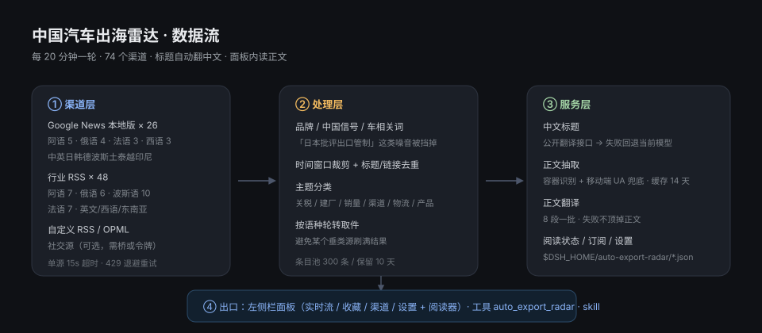

# 中国汽车出海雷达 · DSH 插件

> 左侧栏常驻的出海信息台：15 个语种、74 个渠道定时采集中国汽车出海新闻，标题自动翻成中文，点开条目就能在面板里读正文并一键译成中文。

[](LICENSE)
[](https://github.com/deepseek-ai/deepseek-harness)


**为什么需要它**：中国车出海的消息散在阿语、俄语、波斯语、法语的本地媒体里——中东经销商签约、伊朗市场传闻、哈萨克斯坦建厂、摩洛哥组装线，中文搜索基本搜不到，等行业媒体转载已经晚了两周。通用 RSS 阅读器又不会按「出海」过滤、不会把阿语标题翻成中文、也不知道哪个渠道挂了。

这个插件把这条流水线做进 DSH 侧栏：**捞全 → 过滤 → 去重 → 语种均衡 → 翻中文 → 读正文 → 收藏/未读 → 出简报**。



## 目录

- [功能](#功能)
- [界面结构](#界面结构)
- [安装](#安装)
- [使用](#使用)
- [渠道覆盖](#渠道覆盖)
- [社交源（X / Facebook / Threads）](#社交源-x--facebook--threads)
- [给 agent 用](#给-agent-用)
- [配置](#配置)
- [数据与隐私](#数据与隐私)
- [已知边界](#已知边界)
- [目录结构](#目录结构)
- [常见问题](#常见问题)
- [开发](#开发)
- [许可证](#许可证)

## 功能

| 能力 | 说明 |
|---|---|
| 左侧栏面板 | 和「插件」「媒体工作台」并列的常驻入口，四页：实时流 / 收藏 / 渠道 / 设置 |
| 多语种采集 | 15 语种、26 个 Google News 本地版 + 48 个行业 RSS，共 74 个渠道 |
| 中文标题 | 每个标题自动翻成简体中文；已是中文的原样保留；翻不出的标「待翻译」不阻塞 |
| 面板内读正文 | 点条目右侧开阅读器，正文分段落阅读，缓存 14 天，第二次打开是瞬时的 |
| 正文翻译 | 外文正文点一次「译成中文」，按段翻译（8 段一批），译文与正文一起缓存 |
| 已读 / 收藏 | 未读圆点、已读变灰、星标收藏独立成页，跨重启记忆 |
| 关注词 | 填「沙特、巴西、奇瑞」，命中的条目打星标，也能一键只看关注 |
| 自定义订阅 | 自己加 RSS/Atom 源、启停、删除，支持 OPML 导入导出 |
| 社交源 | 可选接入 X / Facebook / Threads（自建 RSSHub 桥或 X API 令牌） |
| 中文简报 | 一键复制当前筛选的前 30 条为 Markdown，带原文链接 |
| agent 工具 | `auto_export_radar` 给模型直接抓一轮；配套 skill `china-auto-overseas-radar` 教它怎么写简报 |

## 界面结构

```
┌─ 左侧栏 ──┐┌──────────────── 中国汽车出海雷达 ────────────────────────────────┐
│ 插件      ││ 更新于 16:34 · 下次 16:54 · 条目池 198 · 188 未读 · 74/74 正常   │
│ 媒体工作台 ││ [实时流 188] [收藏] [渠道] [设置]      [立即刷新] [自动刷新 ●]  │
│ 出海雷达 ●││ [24小时|3天|7天] [搜标题/来源/市场] [仅未读] [我的关注]        │
│ 定时任务  ││ 全部语种  中文22 EN30 日本語6 …                                 │
│           │├──────────────────────────────────────┬─────────────────────┤
│           ││ ● [EN] BYD teases new flagship MPV…  │ 渠道健康 74/74 正常  │
│           ││   原文：BYD teases new flagship…     │ 语种分布 ▂▄▆█        │
│           ││   Paultan.org · 东南亚 · 12 小时前    │ [复制中文简报]       │
│           ││ ★                                   │                     │
│           │└──────────────────────────────────────┴─────────────────────┘
└───────────┘
```

点条目后右侧展开阅读器：标题（中文 + 原文）→ 元信息（来源/地区/时间/段数）→ 操作栏「译成中文」→ 正文段落。

## 安装

**前置**：DeepSeek Harness 0.2.1 以上（desktop 或 web profile 都可以）。插件是纯 ESM + 浏览器模块，没有构建步骤、没有第三方依赖，不需要 `npm install`。

### 方式一：DSH 界面安装（推荐）

1. 下载或克隆仓库到本机：

   ```bash
   git clone https://github.com/yuyiming-ship-it/dsh-auto-export-radar.git
   ```

2. 打开 DSH → **设置 → 插件 → 添加插件**。
3. 把本机目录的绝对路径填进去，例如 `/Users/you/dsh-auto-export-radar`，确认。
4. 插件出现在「已安装」里并默认启用。
5. **刷新一次窗口**（⌘R），左侧栏出现「中国汽车出海雷达」。

### 方式二：命令行

```bash
git clone https://github.com/yuyiming-ship-it/dsh-auto-export-radar.git
dsh plugin --profile desktop add "$PWD/dsh-auto-export-radar"
# 用 Web 版就把 desktop 换成 web
```

然后重启该 profile；如果插件页没有自动启用，手动打开开关。

### 方式三：打包成 tarball 分发

```bash
cd dsh-auto-export-radar
npm pack            # 得到 dsh-auto-export-radar-1.5.0.tgz
dsh plugin --profile desktop add "$PWD/dsh-auto-export-radar-1.5.0.tgz"
```

### 安装后第一次打开

面板还是空的，会显示「正在抓取多语种新闻…」。首轮要跑 74 个渠道并翻译新标题，**大约 20–40 秒**。之后默认每 20 分钟自动刷一轮，面板开着时 60 秒补一次。

## 使用

### 实时流

- 时间窗口：24 小时 / 3 天 / 7 天；语种、主题、关键词、仅未读、我的关注都能叠加筛。
- 列表分批渲染（每次 40 条），底部「加载更多」。
- 每条：未读圆点 + 语种徽标 + 中文标题 + 原文标题 + 来源 · 地区 · 相对时间 · 主题标签；右上角星标收藏，行尾小图标直接开原站。
- 右栏：渠道健康、语种分布、「复制中文简报」「全部标为已读」。

### 阅读器

- 点条目在右侧打开（窄屏全宽），自动标已读。
- 正文抓不到的站会明确报错（付费墙、403、超时），不会伪造内容；Google News 聚合链接会提示去原站。
- 「译成中文」在正文上方操作栏；翻完后操作栏收起，标题右侧出现「中文 / 原文」切换。
- 翻译失败不顶掉正文：正文照常可读，操作栏里显示原因，按钮留着可以重试。

### 渠道

- 上半部分是社交源，中间是订阅源（内置 + 自己加的），每个源显示本轮条数与报错。
- 加自己的源：填 RSS/Atom 地址、可选名称和语种，保存后立刻触发一轮采集。
- OPML：导入别人的订阅列表，或把自己加过的源导出带走。

### 设置

- 后台采集间隔（10 / 20 / 30 / 60 / 120 分钟）——改完立即重排定时器。
- 标题自动翻译开关（关掉就只留原文标题）。
- 关注词、全部标为已读、清空已读记录。
- 社交连接（自建桥地址 / X 令牌）。

## 渠道覆盖

| 语种 | Google News 本地版 | RSS 源 | 合计 |
|---|---|---|---|
| **阿语** | 沙特、阿联酋、埃及、摩洛哥、科威特 | ArabGT、Assayyarat、Almuraba、Cairo24 汽车、Sky News عربية、الجزيرة اقتصاد、CNN عربية | 12 |
| **俄语** | 俄罗斯、哈萨克斯坦、乌兹别克斯坦、白俄罗斯 | Kolesa、5 колесо、Ведомости·авто、Lenta、NaAvtotrasse、Zamin.uz | 10 |
| **波斯语** | 伊朗 | Pedal、Zoomit、Digiato、دنیای اقتصاد、ایسنا、عصر خودرو、اقتصاد آنلاین、خبرآنلاین、همشهری、مهر | 11 |
| **法语** | 法国、摩洛哥、科特迪瓦 | Automobile Propre、Le Blog Auto、Auto Plus、Auto Moto、Journal Auto、Motors Actu、FrAndroid | 10 |
| 中文 | 中国 | — | 1 |
| 英文 | Global | CarNewsChina、CnEVPost、Automotive World、electric-vehicles.com、InsideEVs、Electrek、Electrive、Nikkei Asia、Paultan、Arab News | 11 |
| 西语 | 墨西哥、西班牙、智利 | Motor.es | 4 |
| 葡语 | 巴西 | Quatro Rodas | 2 |
| 日 / 韩 / 德 / 泰 / 越 / 印尼 / 土 | 各 1 个本地版 | Yonhap、Headlight Mag、Detik Oto、Autonetmagz、VnExpress、Thanh Nien | 12 |

两个和供给有关的提醒：

- **波斯语**：Google News 的波斯语索引很弱（实测一次只回个位数条目），伊朗本地 RSS 才是主力；伊朗媒体关于中国车的日更量本身不大，一天 5–15 条属正常。
- **俄语**：重点不止俄罗斯——哈萨克斯坦、乌兹别克斯坦、白俄罗斯的本地报道经常比俄本土更早披露建厂与 KD 项目，所以这四个市场分开跑。

## 社交源（X / Facebook / Threads）

这三个平台**没有免登录的公开读取通道**（实测 16 个 Nitter 实例、9 个公共 RSSHub 实例、Threads 与 Facebook 页面 HTML、X 官方接口无令牌，全都不通），所以插件不假装能抓，只接两条真实可用的路：

| 方式 | 覆盖 | 怎么开 |
|---|---|---|
| 自建 RSSHub 桥 | X + Facebook + Threads | `docker run -d -p 1200:1200 diygod/rsshub`，把 `http://127.0.0.1:1200` 填进「设置 → 社交源」 |
| X 官方 API v2 | 仅 X | 填 Bearer token；账号写 `BYDCompany`，关键词写 `q:BYD Brazil` |

- 渠道页「社交源」可加账号、一键加示例模板、逐条启停删除，每个账号显示本轮条数或错误。
- 没配桥也没配令牌时：**不发请求、不算故障**，社交渠道显示「待连接」。
- 社交帖文会过一道「是不是车」的过滤（节日祝福、招聘、抽奖不进雷达），条目带「社交」徽标。
- 令牌只存在本机 `state.json`，不回传界面、不写日志。

## 给 agent 用

插件注册了一个工具和一份 skill，装好后在会话里可以直接说「抓最近 24 小时中东和欧洲的出海动态，写一份简报」。

```
auto_export_radar({ hours: 72, limit: 40 })
auto_export_radar({ hours: 24, langs: ['zh','en','ar'], query: 'Saudi Arabia' })
auto_export_radar({ mode: 'feeds', hours: 168, limit: 25 })
```

| 参数 | 说明 |
|---|---|
| `hours` | 时间窗口，默认 72；日报用 24，周报用 168 |
| `limit` | 条数上限，默认 40，最多 200，按语种均衡分配 |
| `langs` | `zh,en,ja,ko,de,fr,ar,fa,es,pt,ru,th,vi,id,tr` 或 `all`；默认 `zh,en,ar,es,ru` |
| `query` | 追加查询，每个语种各跑一次，用来锁定市场/品牌/主题 |
| `mode` | `all` / `news`（只走新闻版）/ `feeds`（只走垂类 RSS） |

返回 `items[]`（`title`、`titleZh`、`source`、`lang`、`region`、`publishedAt`、`link`、`snippet`、`topics`、`via`）、`sources[]`（每个渠道的健康状态与条数）和窗口/命中池等元信息。工具只采集与翻译，不写摘要。

skill `china-auto-overseas-radar` 提供：渠道分层清单、七类主题的归类口径、简报模板、事实红线，以及微信公众号正文的取法。

## 配置

面板里的设置会持久化；也可以用 `cordis.patch.yml` 写死默认值：

```yaml
- insert:
    - id: auto-export-radar
      name: 'dsh-auto-export-radar'
      config:
        refreshMinutes: 20   # 后台采集间隔，5–720
        windowHours: 96      # 每轮采集的时间窗口，6–336
        translate: true      # 关掉就只留原文标题
        bridgeBase: ''       # 可选：自建 RSSHub 地址
        xBearer: ''          # 可选：X API 令牌
```

## 数据与隐私

- 状态全部在本机：`$DSH_HOME/auto-export-radar/state.json`（条目池、译文、已读、收藏、订阅、设置）与 `articles.json`（正文缓存）。不写别的目录，**没有任何遥测**。
- 标题翻译会把标题文本发给公开翻译接口（`translate.googleapis.com`）；接口不可用时回退到你当前默认的模型。关掉「自动翻成中文」就完全不外发。
- 正文翻译只在点按钮时发生，走当前默认模型。
- 社交令牌只存本地 `state.json`，接口只回末四位。
- 卸载插件不会自动删这两个 json；要彻底清干净，手动删目录即可。

## 已知边界

- 只抓标题与正文，不绕付费墙和登录墙；抓不到会明确报错。
- 正文抽取是通用启发式，个别站点会带进导航残留；排版怪的站优先用「打开原文」。
- Google News 聚合链接（`news.google.com/rss/articles/...`）服务端取不到正文，会提示去原站——这类条目在池子里约占一半。
- 观测到永久不可用、因此没有纳入的源：Autostat.ru（403）、Drive.ru（DDoS-Guard）、Motor.ru（鉴权）、Autonews.ru（404）、Auto Infos（403）、Caradisiac（410 关站）、Al Arabiya（网络拒绝）、Asharq Al-Awsat（连接失败）、Khodrobank（RSS 下线，改接 Pedal）。
- 机翻的品牌与车型译名以原文为准，引用前对照原文标题。
- 社交三平台必须自建桥或令牌才有内容；没配置时不该把「社交没动静」理解成「没有相关讨论」。
- 每轮约 74 个 HTTP 请求，默认 20 分钟一次；嫌吵就把间隔调大或只在需要时手动刷新。

## 目录结构

```
dsh-auto-export-radar/
├── package.json           # bundle 清单：dsh.bundle.patch + dsh.client
├── cordis.patch.yml       # 插入插件行
├── index.js               # 宿主入口：HTTP 路由（/auto-export-radar/*）+ 工具 + skill
├── feed.js                # 服务层：定时采集、合并、翻译、阅读状态、订阅、正文缓存
├── radar.js               # 采集层：26 个 Google News 版本、48 个 RSS、过滤/去重/均衡
├── article.js             # 正文抽取：容器识别、实体解码、移动端 UA 兜底
├── social.js              # 社交层：RSSHub 桥 / X API 适配
├── client.js              # 浏览器半边：左侧栏入口 + 四页面板 + 阅读器
├── locale/                # 插件元信息（中/英）
├── skill/radar-guide.md   # 给 agent 的简报口径
└── icon.svg               # 插件图标
```

## 常见问题

**面板一直显示「正在抓取多语种新闻…」** 首轮 20–40 秒；超过 2 分钟看右栏「渠道健康」和底部错误提示，多半是网络代理拦了 `news.google.com`。

**渠道健康不是 74/74** 指到「渠道」页看哪几个源报了什么错。偶发 429/超时是正常的，下一轮会自己恢复；长期 403 的源建议删掉或换地址。

**译成中文没反应** 标题翻译关掉了？或默认模型没配（正文翻译需要模型）。标题翻译优先走公开接口，不需要模型。

**能多开几个面板吗** 每份 profile 只能有一个同名 bundle；想并行看两个市场，用「关注词」+「复制简报」，或复制仓库改包名再装一份。

**会不会很占资源** 空闲时不发请求；一轮 74 个请求、并发 6，CPU 基本无感。

## 开发

- 纯 ESM，`client.js` 是浏览器模块（`window.__ModuleLoader__.load`），没有 JSX、没有构建步骤。
- 宿主侧改动：改完 `node --check`，然后在 DSH 插件页关掉再打开插件即可重载。
- 浏览器侧改动：改完刷新窗口（⌘R）。
- 单文件自检：

  ```bash
  for f in index.js feed.js radar.js article.js social.js client.js; do node --check "$f"; done
  ```

欢迎提 Issue / PR。加渠道只需在 `radar.js` 的 `EDITIONS`（新闻版）或 `FEEDS`（RSS）里加一条，并在 `TOPIC_TERMS` / `BRAND_TERMS` 里补该语种的关键词，否则非拉丁语种的稿子会被过滤掉。

## 许可证

[MIT](LICENSE)。数据与内容版权归各来源媒体所有；插件只做索引与链接。
